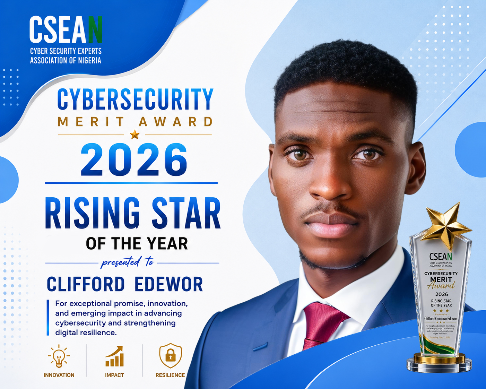
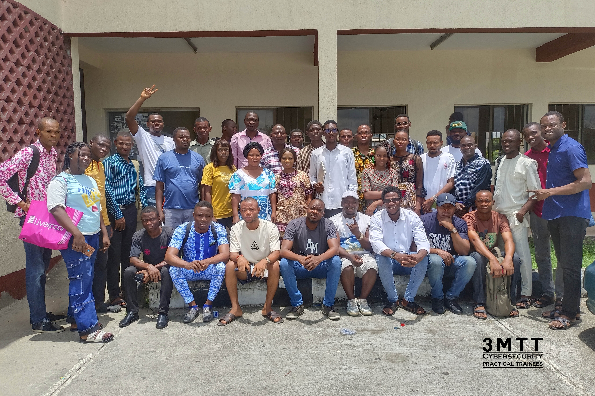
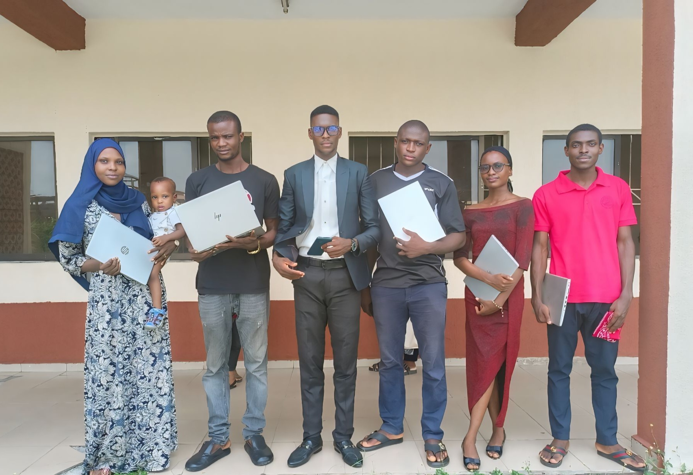
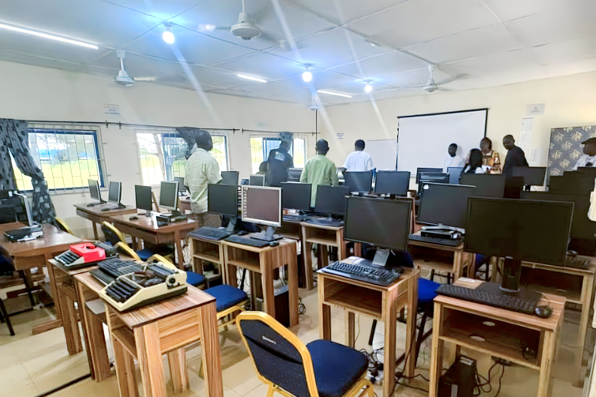
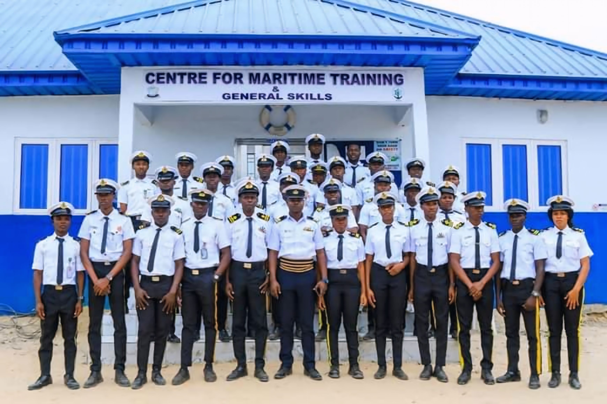

<!-- Cybersecurity Portfolio README -->

  

<h1 align="center">Cybersecurity Portfolio</h1>

  <strong>Cybersecurity Specialist | IT/OT Critical Infrastructure Security | Cloud & Network Security.</strong>

  
  
  

  

---

<h2 align="center">Building Secure, Resilient Digital Systems</h2>

---

### 🧭 About Me

**Cybersecurity Specialist** focused on IT/OT security operations, critical infrastructure protection, incident response, vulnerability management, and cyber resilience across regulated and safety-critical environments.

Recognised nationally as the **CSEAN Rising Star of the Year 2026** (Cybersecurity Merit Awards) for emerging leadership in cybersecurity, critical infrastructure protection, and cybersecurity workforce development.

As an **IT/OT Security Operations Officer at Sinic Engineering Limited (SROL)**, my work focuses on industrial cybersecurity, security monitoring, incident response support, vulnerability management, access controls, and cybersecurity awareness across enterprise and operational technology environments.

My experience spans **industrial cybersecurity, election cybersecurity, detection engineering, cloud security, and Agentic AI security**, including designing and securing agentic AI workflows using Amazon Bedrock AgentCore, AWS Cognito, and the Model Context Protocol (MCP).

I have trained and mentored **500+ learners** in cybersecurity, network security, secure coding, and computer networking through educational institutions and national workforce-development initiatives, including the **NITDA 3 Million Technical Talent (3MTT) Programme**, **PTI** and **Global Maritime Academy.**

I am committed to strengthening **critical infrastructure security**, advancing the secure adoption of emerging technologies, and developing the next generation of cybersecurity talent.

---

### 🛠️ Skills & Tools

Core capabilities spanning IT/OT security, critical infrastructure protection, monitoring, incident response, and governance frameworks.

#### 🧩 Security & Monitoring

#### 🏭 Industrial Security

#### ☁️ Cloud & Networks

#### 💻 Programming & Scripting

#### 📚 Governance, Risk & Compliance

#### 🎓 Education & Training

---

### 🚀 Featured Projects

### 🔹 [Agentic AI Security at Scale with Strands Agents & Bedrock AgentCore](https://github.com/CliffordEdewor/agentic-ai-security-bedrock-strands)
Production-oriented Agentic AI security reference architecture using AWS Cognito, MCP Gateway, Strands Agents and Amazon Bedrock AgentCore, demonstrating secure design, deployment and observability.

### 🔹 [Secure MCP Agent Integration for AI Tooling](https://github.com/CliffordEdewor/secure-mcp-agent-integration)
Secure agent-tool integration using the Model Context Protocol (MCP) with deployment on AWS AgentCore, demonstrating controlled tool invocation and secure interaction patterns for agentic AI systems.

### 🔹 [Snort IDS Threat Detection](https://github.com/CliffordEdewor/Snort-IDS-Threat-Detection)
Engineered and validated a Snort IDS solution for real-time threat detection, custom rule development, security monitoring, and alert generation within a virtualised enterprise-style network environment.

### 🔹 [IoT Security: Mitigating Cybersecurity Threats in Connected Devices](https://github.com/CliffordEdewor/IoT-Security-Mitigating-Cybersecurity-Threats-in-Connected-Devices)
Security architecture and layered defence strategies for protecting Internet of Things (IoT) environments through practical security design principles.

### 🔹 [Online Voting System](https://github.com/CliffordEdewor/Online-Voting-System)
Secure web-based voting platform demonstrating authentication, election integrity, secure vote casting, and trusted digital voting workflows.

### 🔹 [Network Traffic Security Analysis](https://github.com/CliffordEdewor/Network-traffic-security-analysis)
A Cisco Packet Tracer project demonstrating how hubs broadcast all traffic and how switches intelligently forward frames to improve security and prevent sniffing.

---

### 📊 Highlights & Achievements

- 🏆 Winner, **CSEAN Rising Star of the Year 2026**, awarded by the [Cyber Security Experts Association of Nigeria (CSEAN)](https://csean.org.ng/) for emerging leadership in cybersecurity and workforce development.

- 🗳️ Coordinated election cybersecurity operations across **192 polling units and 10 registration areas** during Nigeria’s 2023 General Elections, connecting field teams to the Situation Room and training **200+ polling personnel** on secure electoral technology.

- 📝 Served as an **Expert Cybersecurity Advisor** to Unicus Campus, designing its core training curriculum around real-world threat scenarios and practical competencies. The programme has trained **50+ emerging professionals** to date.

- ☁️ **Led the technical preparation and operational readiness** of GMA's Networking & Cloud Computing Laboratory, contributing to [National Board for Technical Education (NBTE)](https://web.nbte.gov.ng/) approval for the **Academy's first HND programmes**.

- 🎓 Trained and mentored **500+ learners** through **PTI**, **GMA**, and the [National Information Technology Development Agency (NITDA)](https://nitda.gov.ng/) **3MTT cybersecurity programme**, delivering practical cybersecurity training and hands-on infrastructure labs.

- 🛡️ Delivered hands-on cybersecurity training through [NITDA’s 3MTT Programme](https://3mtt.nitda.gov.ng/), with **~20% of participants achieving career-development outcomes**, including earning ISC2 Certified in Cybersecurity (CC) or CompTIA Security+ certifications, securing internships, or progressing into entry-level cybersecurity roles.

- 🔐 **Supervised cybersecurity and networking projects** at [Global Maritime Academy](https://gma.edu.ng/), strengthening students’ practical technical skills.

- 👨‍💻 Served as the **Inaugural HND President** of the [Nigeria Association of Computing Students (NACOS)](https://nacos.org.ng/) PTI Chapter, establishing governance structures and leading student initiatives in cybersecurity and emerging technologies.

---

### 📸 Leadership in Action

**Leadership experience spanning institutional, national, and professional cybersecurity initiatives, driving capacity development and digital resilience.**

#### 🏆 Industry Recognition & Professional Impact

  
 
<em>Recognised by the Cyber Security Experts Association of Nigeria (CSEAN) with the Rising Star of the Year 2026 Award.</em>

 

### 🧠 Cybersecurity Workforce Development & National Impact  

  
  
  
<em>Delivered hands-on cybersecurity training under NITDA's 3 Million Technical Talent (3MTT) Programme, enabling learners to achieve internationally recognised certifications, internships, entry-level cybersecurity roles, and national recognition.</em>

### 🏫 Institutional Development & Technical Leadership

  
  
   
<em>Delivered hands-on cybersecurity and networking instruction while leading the technical preparation and operational readiness of the Networking Laboratory, enabling the approval and launch of the institution's first HND programmes in Networking and Cloud Computing.</em>

---

### 🏛️ Professional Memberships
- **Cyber Security Experts Association of Nigeria (CSEAN)** — Professional Member
- **Nigeria Computer Society (NCS)** — Associate Member

---

### 📫 Connect With Me

---

### 💬 Quote

  <strong><em>"Protecting critical infrastructure demands secure engineering, resilient systems, and skilled defenders."</em></strong>

---

  <i>© 2026 Clifford Edewor – Building Secure, Resilient Digital Systems</i>

